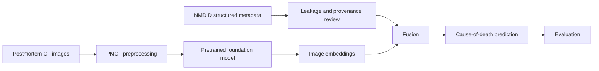

# Multimodal AI for Cause-of-Death Estimation from Postmortem Data

Group 2's CSE 499A capstone at the Department of Electrical and Computer Engineering explores estimating broad cause-of-death categories from postmortem computed tomography (PMCT) and non-leaky structured metadata from the New Mexico Decedent Image Database (NMDID). The goal is to measure what imaging adds beyond metadata; the current results are metadata-only, and no image or multimodal results exist yet.

## Project status

| Workstream | Status |
|---|---|
| Metadata collection and preparation | Done |
| Metadata-only models | Done |
| TabPFN experiment | Done |
| Age ablation | Done |
| PMCT preprocessing | Not started |
| PMCT embeddings | Pending |
| Multimodal fusion | Pending |

## Pipeline



The PMCT preprocessing, embedding, and fusion stages have not started. The existing evaluation uses structured metadata only.

## Results so far

The metadata cohort contains 860 decedents across five broad classes: intoxication (366), cardiac (202), blunt trauma (149), stab (79), and firearm (64). The 70 numerical features are grouped as basic metadata (5), diagnoses (22), medical history (5), substance use (10), lifestyle (12), and medications (16). Tier 1 uses the five basic features; Tier 1+2 uses all 70.

Scores below are mean macro-F1 from repeated stratified five-fold cross-validation with two repeats and seed 42. Chance-level macro-F1 is about 0.20.

| Model | Tier 1 (5 basic features) | Tier 1+2 (70 features) |
|---|---:|---:|
| TabPFN | 0.2193 | 0.2868 |
| Logistic Regression | 0.2446 | 0.3156 |
| Random Forest | 0.2436 | 0.3399 |

The age-and-sex-only baseline scores are 0.2235 for Logistic Regression and 0.2341 for Random Forest. Removing age lowers the Random Forest Tier 1+2 score from 0.3399 to 0.3364.

Intoxication and cardiac cases are predicted better than firearm, stab, and blunt-trauma cases; blunt trauma is often confused with stab. Cardiac cases are older on average (mean age 51.7 years versus about 43 years). These are preliminary metadata-only findings from cross-validation, not held-out test results.

**No PMCT image results or multimodal results exist yet.** The best current macro-F1 is approximately 0.34 and is preliminary.

## Repository structure

```text
.
├── data/                 # data/README.md only; local data is ignored
├── docs/                 # project, data, methods, leakage, experiments, roadmap
├── reports/figures/      # aggregate result figures
├── results/              # aggregate CSVs only
├── scripts/              # analysis scripts
├── .github/              # pull request and issue templates
├── CHANGELOG.md
├── CONTRIBUTING.md
├── LICENSE
├── README.md
└── requirements.txt
```

## Setup and how to run

Request and download approved data separately; it is not included in this repository. Place the authorized local feature matrix at `data/metadata_feature_matrix.csv`. Git ignores this file.

From the repository root, create a Python virtual environment and install dependencies:

```powershell
python -m venv .venv
.\.venv\Scripts\Activate.ps1
python -m pip install -r requirements.txt
```

Run the scripts from the repository root:

```powershell
python scripts\compare_models.py
python scripts\run_tabpfn.py
python scripts\analyze_tabpfn.py
python scripts\age_analysis.py
python scripts\age_ablation.py
python scripts\fix_age_chart.py
```

The scripts write aggregate CSVs to `results/` and figures to `reports/figures/`. `compare_models.py` uses the existing `results/tabpfn_results.csv`, so run `run_tabpfn.py` before `compare_models.py` if regenerating results from scratch. TabPFN evaluation may take substantial time and may require model downloads or additional compute.

## Data access

No NMDID records or medical images are included in this repository. See [data access guidance](docs/data_access.md) and the [NMDID website](https://nmdid.unm.edu) for access requests. Follow the database access terms and any institutional approvals. Never publish person-level data or identifiers.

## Leakage policy

The intended prediction must not use fields that reveal the outcome or acquisition/identification details. Exclude cause and manner of death, scan protocol/settings, identification method, location fields, and IDs. Treat time delay after death as a nuisance variable. History-based features require provenance and timing verification and are reported separately from the five-feature Tier 1 baseline. See [the full leakage policy](docs/leakage_policy.md).

## Limitations

- The five classes are imbalanced.
- The source and timing of history, substance-use, and medication fields have not yet been verified; these may leak information about the outcome.
- Evaluation is cross-validation only; there is no held-out test set yet.
- PMCT access is pending, so there are no image-only or multimodal results.
- The best current score, macro-F1 about 0.34, is preliminary and should not be treated as clinical or forensic performance.

## Roadmap

1. Verify feature definitions and provenance against the NMDID data dictionary.
2. Freeze train, validation, and test splits by decedent and document cohort selection.
3. Obtain approved PMCT images and test preprocessing.
4. Extract embeddings with a pretrained model.
5. Compare metadata-only, PMCT-only, and multimodal fusion models.

See [the roadmap](docs/roadmap.md) for details.

## Team and supervisor

- **Team:** Group 2
- **Course:** CSE 499A
- **Supervisor:** Dr. Sumaiya Tabassum Nimi
- **Department:** Electrical and Computer Engineering

## Citation

Berry and Edgar, “Announcement: The New Mexico Decedent Image Database,” *Forensic Imaging*, vol. 24, 200436, 2021. https://doi.org/10.1016/j.fri.2021.200436

## License

This project is released under the MIT License. See [LICENSE](LICENSE).
